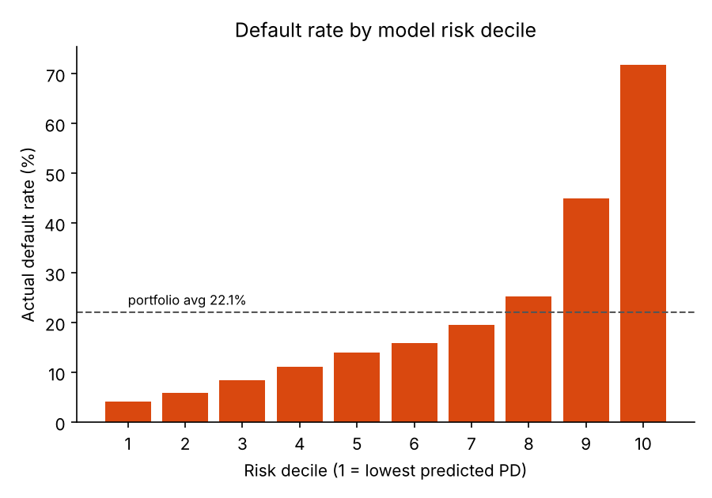
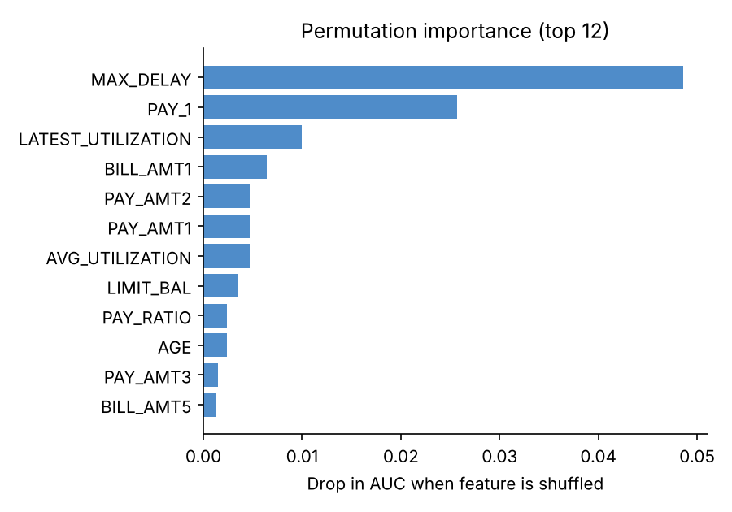
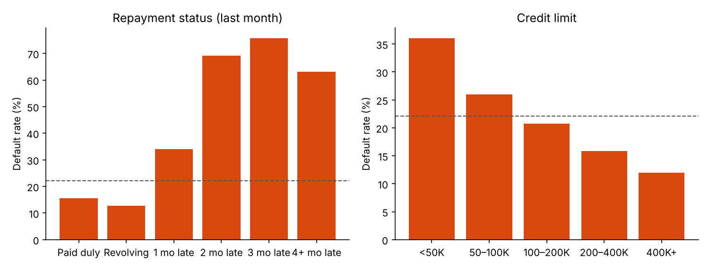

# Loan Default & Credit Risk Dashboard

End-to-end credit-risk project on the **UCI Credit Card Default** dataset (30,000 Taiwanese cardholders, Apr–Sep 2005).
It cleans the data, engineers behavioural risk features, compares three models, turns predictions into **risk bands**, and presents everything in a dashboard.

| | |
|---|---|
| **Task** | Predict whether a cardholder defaults on next month's payment (binary, 22.1% positive) |
| **Best model** | Gradient Boosting — **ROC-AUC 0.792**, KS 0.444, PR-AUC 0.579 on a held-out test set |
| **At the F1-optimal threshold (0.27)** | Recall 59%, precision 53% |
| **Risk ranking** | Default rate rises from **4.2%** (lowest-risk decile) to **71.8%** (highest); the top 20% of customers contain **53%** of all defaults |



## Dashboards

* **Static dashboard** – `docs/index.html` (no dependencies; open it in a browser or serve it with GitHub Pages: *Settings → Pages → Branch `main`, folder `/docs`*).
* **Streamlit app** – KPIs, segment explorer, model performance, and a **"Score a customer"** tab that returns probability of default and a risk band.

```bash
pip install -r requirements.txt
streamlit run app.py
```

## Reproduce

```bash
python src/train.py            # trains models, writes reports/results.json + models/best_model.joblib
python src/make_figures.py     # README figures
python src/build_dashboard.py  # regenerates docs/index.html
python src/predict.py          # scores a few example customers
```

## Method

1. **Cleaning** – undocumented `EDUCATION` codes (0, 5, 6) merged into "Other"; `MARRIAGE=0` merged into "Other"; `PAY_0` renamed `PAY_1`. No missing values.
2. **Features** – average / latest credit utilisation, payment-to-bill ratio, max and mean payment delay, number of late months, bill trend.
3. **Split** – stratified 60 / 20 / 20 (train / validation / test). Model and decision threshold are chosen on validation; every number reported above is from the untouched test set.
4. **Models** – Logistic Regression (scaled), Random Forest, Histogram Gradient Boosting.

| Model | ROC-AUC | PR-AUC | KS |
|---|---|---|---|
| Logistic Regression | 0.758 | 0.520 | 0.420 |
| Random Forest | 0.788 | 0.574 | 0.440 |
| **Gradient Boosting** | **0.792** | **0.579** | **0.444** |

## Key findings

* **Recent delinquency dominates.** Max payment delay and last month's repayment status are the top two drivers by far. Customers 2+ months late default ~63–76% of the time vs ~13–16% for those paying duly or revolving.
* Utilisation of the credit limit adds signal after delinquency; demographics add little.

 

## Responsible-use notes

* `SEX` and `MARRIAGE` are **excluded** from the model inputs (protected characteristics in most lending regimes). `AGE` is retained for demonstration; check local regulation before using it in production.
* The data is a 2005 Taiwanese card portfolio. The model has not been validated out-of-time or on other populations, so treat it as a portfolio/analysis demo, not a production scorecard.
* Thresholds should be set from business costs (cost of a missed default vs a declined good customer), not just F1.

## Structure

```
app.py                  Streamlit dashboard
data/                   UCI_Credit_Card.csv
docs/index.html         Static dashboard (GitHub Pages ready)
models/                 best_model.joblib
reports/                results.json + figures/
src/                    features.py, train.py, predict.py, make_figures.py, build_dashboard.py
```

Dataset: Yeh, I. C., & Lien, C. H. (2009). *The comparisons of data mining techniques for the predictive accuracy of probability of default of credit card clients.* UCI Machine Learning Repository.
